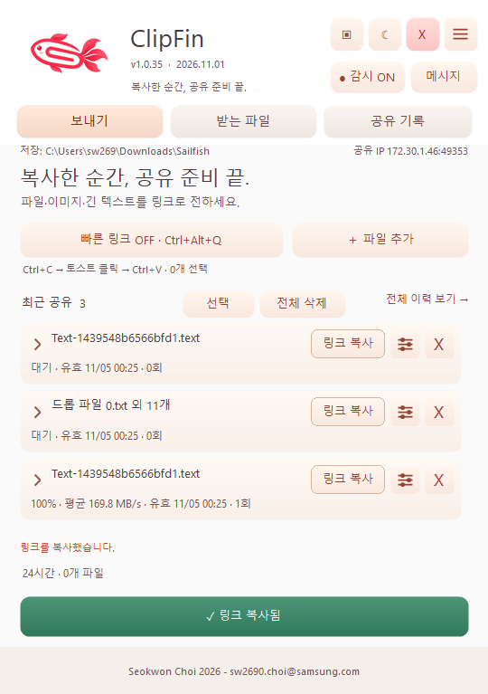
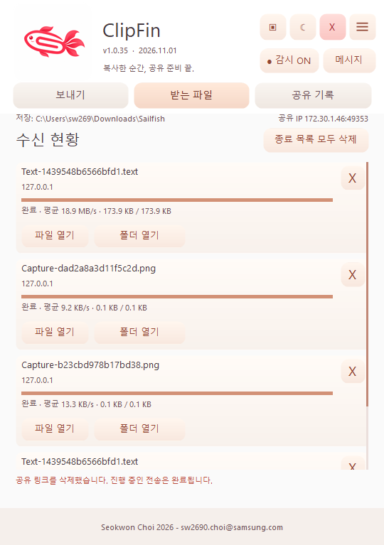
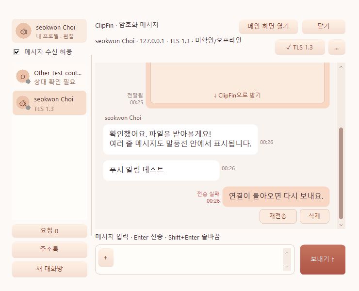
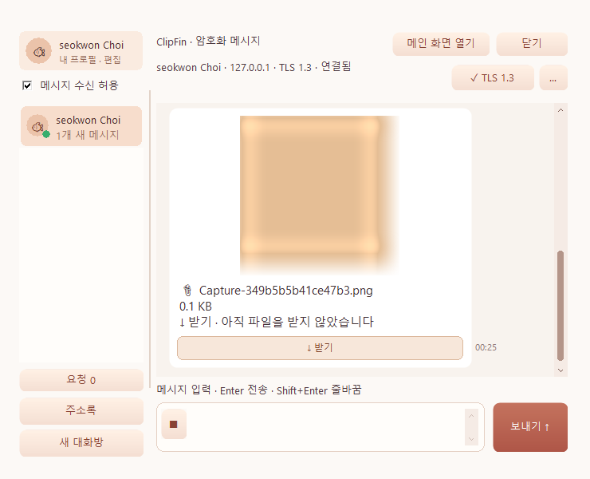
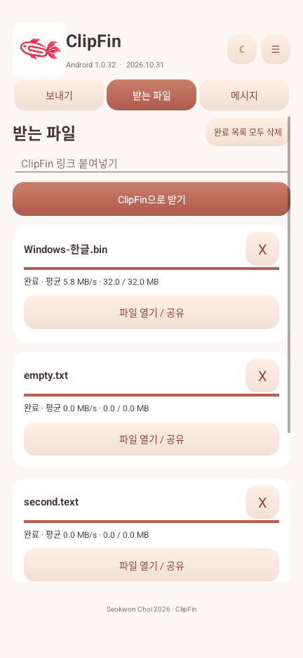
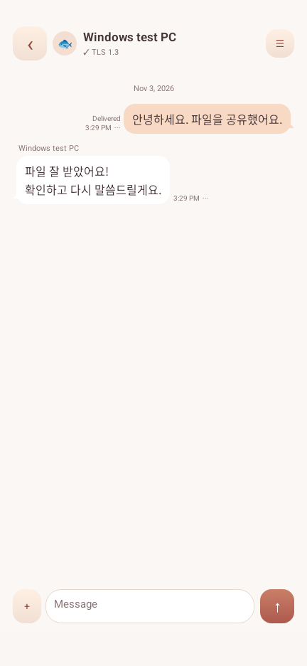

# ClipFin 사용 매뉴얼

Windows 1.0.35 · Android 1.0.32 기준 | 2026년 11월

ClipFin은 파일, 이미지와 긴 글을 링크로 공유하고 기기끼리 메시지를 주고받는 프로그램입니다. 처음 사용한다면 **시작하기 → 첫 파일 보내기 → 받기** 순서로 따라 해 보세요.

> 화면은 테스트 환경의 예시입니다. 메시지 화면은 Windows 1.0.35 수정 빌드 기준이며, 일부 공유·Android 화면은 이전 버전에서 촬영하여 세부 버튼이 다를 수 있습니다. 설명은 위의 배포 버전을 기준으로 합니다.

## 1. 시작하기 전에

- Windows는 Windows 11 x64용입니다. Android는 Android 10 이상에서 사용할 수 있습니다.
- 보내는 기기와 받는 기기가 서로 접근할 수 있는 사내 네트워크나 VPN에 연결되어야 합니다. 같은 Wi-Fi에 있어도 기기 간 연결을 차단하는 네트워크에서는 동작하지 않을 수 있습니다.
- 파일은 클라우드에 보관되는 방식이 아닙니다. **받기가 끝날 때까지 보내는 기기의 ClipFin과 네트워크 연결을 유지**하세요.
- 공유 링크를 아는 접근 가능한 사람은 파일을 받을 수 있습니다. 링크를 공개 게시하거나 불필요하게 전달하지 마세요. 파일 전송은 HTTP이며 메시지의 암호화 연결과 다릅니다.

### 설치와 처음 실행

**Windows:** 제품 페이지의 다운로드에서 Windows ZIP을 받고 압축을 푼 뒤 `ClipFin.exe`를 실행합니다. 처음 실행할 때 초기 설정과 방화벽 허용을 요청할 수 있습니다. 승인하지 않거나 조직 정책이 차단하면 공유 서버가 시작되지 않을 수 있습니다. 전체 메뉴의 **초기 설정 다시 실행**으로 재시도할 수 있습니다. 바탕화면 바로가기 생성 여부도 선택할 수 있습니다.

**Android:** Android 릴리스 APK를 내려받아 설치하고 ClipFin을 엽니다. Android 설치 화면에서 필요한 설치 허용을 진행하세요. 앱에서 요청하는 알림과 로컬 네트워크 관련 권한은 안내에 따라 허용합니다. PC와 서로 접근 가능한 Wi-Fi 또는 VPN에 연결합니다.

## 2. 한눈에 보는 공유 흐름

```text
보내는 사람                         받는 사람
파일·이미지·글 선택                 링크 열기
       ↓                               ↓
공유 링크 만들기 ── 메신저로 전달 ──→ 브라우저 또는 ClipFin으로 받기
       ↓                               ↓
앱과 네트워크 유지                  수신 완료 확인
```

**공유 링크**는 파일이 들어 있는 인터넷 주소처럼 보이지만, 실제로는 보내는 기기에 직접 연결하는 주소입니다. **클립보드**는 복사한 내용을 잠시 보관하는 공간이고, **토스트**는 화면에 잠깐 나타나는 알림입니다.

## 3. Windows 화면과 첫 공유



위 화면에서 상단의 **보내기 / 받는 파일 / 공유 기록** 탭으로 이동합니다. **감시 ON**은 새로 복사한 공유 가능한 내용을 살펴보는 상태입니다. ☰는 전체 메뉴, 각 공유 항목 오른쪽의 조절 모양 버튼은 해당 링크의 설정입니다. 화면의 파일명과 횟수는 테스트 예시입니다.

### 파일을 복사해서 보내기

1. 보내는 PC에서 ClipFin을 실행하고 감시가 ON인지 확인합니다.
2. 탐색기에서 파일 하나 또는 여러 개를 선택하고 **Ctrl+C**를 누릅니다.
3. 나타나는 ClipFin 알림을 클릭합니다. 공유 링크가 클립보드에 복사됩니다.
4. 메신저의 입력창에서 **Ctrl+V**로 붙여넣고 상대에게 보냅니다.
5. 상대가 다운로드를 완료할 때까지 ClipFin을 켜 둡니다.

이미지나 긴 텍스트도 복사한 뒤 같은 방법으로 보낼 수 있습니다. 알림 클릭 전에 다른 내용을 복사하면 최신 복사 내용이 대상이 됩니다. 이미 만들어진 링크는 따로 유지됩니다. 앱이 시작되기 전에 복사한 내용은 자동 공유되지 않습니다.

### 파일 추가와 끌어놓기

**보내기 → 파일 추가**를 눌러 파일을 고르거나 탐색기에서 파일을 ClipFin 창으로 끌어놓습니다. 여러 파일을 하나의 링크로 묶을 수 있습니다. 화면의 링크 만들기/복사 동작을 실행하거나 생성된 항목의 **링크 복사**를 누른 다음 메신저에 붙여넣습니다.

### 감시와 빠른 링크

- **감시 ON/OFF:** 상단 감시 버튼, 트레이 메뉴 또는 **Ctrl+Alt+S**로 전환합니다. 프로그램을 다시 시작하면 감시는 ON으로 시작합니다. 감시 상태 알림을 숨겨도 감시는 계속됩니다.
- **빠른 링크:** 보내기 화면에서 켠 뒤 다른 앱에서 파일이나 텍스트를 선택하고 **Ctrl+Alt+Q**를 누릅니다. ClipFin가 복사를 요청하고 새 클립보드 내용을 기다려 링크를 만듭니다. 기본값은 OFF입니다. 단축키 충돌, 관리자 권한 앱 또는 터미널에서는 동작이 제한될 수 있습니다.
- 트레이는 작업 표시줄 오른쪽의 아이콘 영역입니다. 창 제목 표시줄의 X는 창을 트레이로 숨길 수 있습니다. 프로그램 내부의 종료 버튼이나 트레이 종료 메뉴로 실제 종료합니다.

### 화면 캡처

상단 캡처 메뉴 또는 트레이에서 다음 동작을 선택합니다. 영역은 마우스로 드래그하고 창은 대상 창을 선택합니다. Esc로 취소할 수 있습니다. 창 캡처는 화면에서 가려진 부분을 복원하지 않습니다.

| 메뉴 | 단축키를 켰을 때 | 완료 후 동작 |
| --- | --- | --- |
| 영역 캡처 → 클립보드 | Ctrl+Alt+1 | 이미지 자체를 복사합니다. 메시지 입력창에 Ctrl+V로 붙여넣고 미리보기의 보내기를 누릅니다. |
| 영역 캡처 → 링크 | Ctrl+Alt+2 | 이미지 공유 링크를 복사합니다. |
| 전체 화면 캡처 | Ctrl+Alt+3 | 전체 모니터를 캡처하고 공유 링크를 복사합니다. |
| 창 선택 캡처 | Ctrl+Alt+4 | 선택한 창을 캡처하고 공유 링크를 복사합니다. |

**캡처 단축키 사용**을 켜면 위 단축키를 사용할 수 있습니다. 단축키 충돌 시 다른 프로그램의 설정을 확인하세요. 메뉴는 단축키 설정과 관계없이 사용할 수 있으며, 캡처는 클립보드 감시가 꺼져 있어도 작동합니다.

## 4. 공유 관리와 받기

### 유효기간과 횟수

보내기 또는 공유 기록의 항목에서 **공유 설정**을 열어 유효기간을 지금부터 1시간, 4시간 또는 24시간으로 변경할 수 있습니다. 다운로드 횟수는 파일당 1회, 3회 또는 제한 없음으로 설정할 수 있습니다. 그룹 설정은 그룹의 파일들에 적용하고 개별 파일 메뉴는 해당 파일에 적용합니다. 설정을 바꿔도 이미 사용한 횟수는 초기화되지 않습니다.

항목을 펼치면 파일별 진행 상황과 수신 기기 정보를 확인할 수 있습니다. 표시된 기기 이름과 IP는 인증된 사용자 신원과 같지 않습니다. 링크의 **X**를 누르면 새로운 다운로드가 차단되지만 이미 시작된 전송은 완료될 수 있습니다. 선택 삭제나 전체 삭제도 사용할 수 있습니다.

### 브라우저에서 받기

1. 전달받은 링크를 브라우저에서 엽니다.
2. 파일 이름 옆 다운로드를 누르거나, 여러 파일이면 전체 ZIP 받기를 선택합니다.
3. 이미지와 텍스트는 제공되는 미리보기로 내용을 확인할 수 있습니다. 텍스트는 복사하거나 파일로 받을 수 있습니다.

링크가 열리지 않으면 보내는 앱이 켜져 있는지, 네트워크가 연결되는지, 유효기간과 횟수가 남았는지 확인하세요. 브라우저에서만 받으면 메시지용 상대가 자동 등록되지 않습니다.

### ClipFin으로 받기

양쪽 기기에서 ClipFin을 실행한 뒤 공유 페이지의 **ClipFin으로 받기**를 이용하거나, 앱의 받는 화면에 링크를 입력합니다. 여러 파일은 각각 진행 상태가 표시됩니다. 수신을 중지한 뒤 같은 유효한 링크로 다시 받으면 저장된 진행 상태를 이용해 이어받을 수 있습니다. 링크가 만료되거나 삭제되었거나 횟수 제한에 도달한 경우에는 새 링크가 필요할 수 있습니다.



Windows에서는 받는 파일 화면에서 현재 수신 묶음을 중지할 수 있습니다. 완료 항목의 X 또는 완료 목록 정리는 **목록 표시만 삭제**하며 받은 파일을 지우지 않습니다. 기본 저장 위치는 전체 메뉴의 **받는 경로**에서 변경할 수 있습니다.

## 5. 메시지 사용하기

### 상대 등록과 확인

- 파일 공유로 등록하려면 두 기기에서 ClipFin을 실행하고 한쪽의 링크를 다른 쪽에서 **ClipFin으로 받기**로 수신합니다. 브라우저로만 받으면 메시지 상대가 자동 등록되지 않습니다.
- Windows에서는 **메시지 → 주소록 → 새 항목**에 상대 이름과 IPv4를 저장해 등록 요청을 보낼 수도 있습니다. 상대가 이름·IP·인증서를 확인하고 수락하면 TLS 등록을 완료합니다.
- 요청은 메시지 창 왼쪽 아래 **요청** 또는 더보기의 **등록·그룹 초대 요청**에서 확인합니다. 모르는 요청은 수락하지 마세요.
- 필요하면 **상대 확인**에서 양쪽 기기의 확인 코드를 직접 또는 전화로 비교하고 **일치합니다**를 선택합니다. 코드가 다르거나 인증서 변경 경고가 나오면 확인 전까지 승인하지 마세요.

메시지와 메시지 첨부는 상대 기기 인증서를 확인하는 TLS 1.3 연결을 사용합니다. 회사 계정 인증을 대신하지는 않습니다. **새 대화방**에서 확인된 Windows 참여자를 초대할 수 있으며 각자가 초대를 수락합니다. 방장이나 상대가 오프라인이면 메시지는 발신 PC에서 대기하고 발신 앱이 실행 중일 때 재전송됩니다. Android는 1:1 대화를 지원합니다.

### 대화와 파일 링크



상대를 선택해 입력창에 글을 쓴 뒤 **보내기** 또는 **Enter**를 누릅니다. **Shift+Enter**는 줄바꿈입니다. 한글 조합 중 Enter는 먼저 조합을 확정합니다. 일반 메시지는 최대 8,000자이며 더 긴 글은 `.text` 첨부로 보냅니다. **전달됨**은 상대 앱이 저장하고 응답했다는 뜻이며 읽었다는 뜻은 아닙니다. 전송에 실패하면 해당 메시지의 **재전송**이나 **삭제**를 선택할 수 있습니다.

메시지에 ClipFin 링크를 붙여 보내면 말풍선의 **ClipFin으로 받기**로 파일을 받을 수 있습니다. 이미지 미리보기는 접근 가능한 8 MiB 이하 이미지에 표시되며 미리보기 조회는 다운로드 횟수를 소모하지 않습니다. 보내는 기기가 켜져 있어야 합니다.

**메인 화면 열기**는 메시지 창 오른쪽 위 닫기 왼쪽에 있습니다. 메시지 창과 작성 중인 초안을 유지한 채 메인 화면을 앞으로 표시합니다. **닫기**는 메시지 창을 숨기며 메시지 수신 설정을 끄지 않습니다. 마지막 창 위치와 크기는 다시 실행할 때 복원됩니다.

**Ctrl+마우스 휠**로 대화 본문 글자 크기를 8~24pt 범위에서 조절합니다. 크기는 다음 실행에도 유지됩니다. 일반 휠은 대화를 스크롤합니다. 라이트·다크 테마는 메인 전체 메뉴에서 전환하며 메시지 버튼과 스크롤바에도 적용됩니다.



**+**로 파일을 첨부하거나 클립보드 이미지를 입력창에 **Ctrl+V**로 붙여넣습니다. 이미지 미리보기 옆 보내기를 눌러 전송하며, 상대가 **받기**를 누르면 다운로드합니다. 완료 카드의 **파일 열기**와 **폴더 열기**는 각각 파일과 저장 위치를 엽니다.

더보기의 **메시지 알림 설정**에서 작업 표시줄 깜빡임·소리와 백그라운드 알림 여부를 조절할 수 있습니다. 프로필 카드를 클릭하면 내 표시 이름과 얼굴 이미지를 바꾸고, 왼쪽 목록 경계선을 드래그하면 목록 폭을 조절합니다.

상대 메뉴에서 내 목록에 표시할 이름을 바꾸거나 해당 상대의 메시지 수신을 거부할 수 있습니다. 메시지 수신 거부와 파일 공유는 별개입니다. 메시지 메뉴에서 개별·선택·전체 삭제를 할 수 있으며, 삭제는 **내 기기의 대화 기록**에 적용됩니다. 상대의 기록이나 공유 링크는 삭제되지 않습니다.

## 6. Android 사용하기

Android에서는 다른 앱의 클립보드를 백그라운드에서 상시 감시하지 않습니다. 다른 앱의 **공유 → ClipFin**를 이용하거나 ClipFin 화면에서 파일·이미지를 고르고 텍스트를 붙여넣어 링크를 만듭니다. 링크를 복사해 상대에게 전달하세요. 공유 링크가 유효하고 상대가 받을 동안 연결이 유지되어야 합니다.

### 파일 받기와 관리

Windows에서 받은 링크를 Android의 **받는 파일** 화면에 붙여넣거나 공유 페이지의 **ClipFin으로 받기**를 이용합니다. 진행 중인 파일별 중지 버튼으로 해당 파일을 멈출 수 있고, 유효한 같은 링크로 다시 받아 이어받을 수 있습니다. 완료 항목 X와 완료 목록 모두 삭제는 목록만 정리합니다.



완료된 파일은 앱 전용 Downloads 공간에 보관됩니다. 필요한 파일은 앱의 열기/공유를 이용해 별도 위치에도 보관하세요. **앱을 삭제하면 앱 전용 파일과 대화 및 키가 삭제됩니다.**

### Android 메시지와 백그라운드



파일을 ClipFin으로 수신해 상대를 등록하고 양쪽 확인 코드를 비교한 뒤 대화합니다. 대화 메뉴에서 이름 변경, 상대 확인, 수신 거부와 메시지 선택/전체 삭제를 사용할 수 있습니다. 말풍선 옆 메뉴 또는 말풍선 여백을 길게 눌러 개별 메시지를 관리합니다.

Android 앱이 열려 있을 때 새 메시지를 수신합니다. 앱을 벗어나면 진행 중 작업이나 유효한 공유 링크를 위해 서비스가 유지될 수 있지만, 백그라운드에서 새 메시지를 수신하는 클라우드 푸시는 제공하지 않습니다. 지속 알림의 Stop 또는 **PC 연결 종료**로 서버를 중지할 수 있습니다.

## 7. 업데이트

Windows는 시작할 때와 실행 중 **4시간마다** 업데이트를 확인합니다. 메인 화면의 버전 표시를 눌러서도 확인할 수 있습니다. 전체 메뉴의 **업데이트 확인**으로 즉시 확인할 수도 있습니다. 새 버전이 있으면 안내를 열어 다운로드하고 **지금 설치** 또는 **실제 종료할 때 설치**를 선택합니다. 창을 트레이로 숨기는 것은 실제 종료가 아닙니다.

Android도 앱을 열 때와 화면이 열려 있는 동안 4시간마다 확인합니다. Windows와 Android의 업데이트는 별도입니다. Android는 다운로드와 검증 후 시스템 설치 화면에서 사용자가 설치를 승인해야 합니다. 처음에는 이 출처에서 설치를 허용해야 할 수 있으며, 설정 후 전체 메뉴의 **다운로드한 업데이트 설치**로 계속할 수 있습니다.

## 8. 문제 해결

| 증상 | 확인할 사항 |
| --- | --- |
| 복사했는데 알림이 안 보임 | Windows 감시가 ON인지, 프로그램 시작 후 새로 복사했는지 확인합니다. Android는 공유 메뉴를 사용합니다. |
| 링크가 열리지 않음 | 보내는 앱이 켜져 있는지, 두 기기의 네트워크/VPN 연결 및 방화벽, 링크 만료와 삭제 여부를 확인합니다. |
| 다운로드가 중단됨 | 네트워크와 보낸 기기를 확인하고 같은 유효 링크로 다시 시도합니다. 만료·삭제·횟수 초과 시 새 링크를 요청합니다. |
| 메시지 상대가 보이지 않음 | 브라우저 다운로드가 아니라 양쪽 앱이 켜진 상태에서 ClipFin으로 파일을 받아 등록합니다. |
| 메시지 전송 실패 | 상대 앱 실행과 네트워크, 상대 확인 및 수신 거부 설정을 확인한 뒤 재전송합니다. 주소가 바뀌었다면 파일을 다시 앱으로 받아 연결 정보를 갱신합니다. |
| 단축키가 동작하지 않음 | 기능을 켰는지와 다른 앱과의 충돌을 확인합니다. 관리자 권한 앱과 터미널은 입력 전달이 제한될 수 있습니다. |
| 업데이트가 설치되지 않음 | 네트워크를 확인합니다. Windows는 실제 종료 여부를, Android는 설치 출처 허용과 시스템 설치 승인을 확인합니다. |

조직의 보안 정책이 연결을 차단하면 IT 담당자에게 문의하세요. Windows 초기 설정은 앱에 필요한 TCP 49352–49371 범위의 방화벽 규칙을 사용하며 조직 정책을 우회하지 않습니다.
